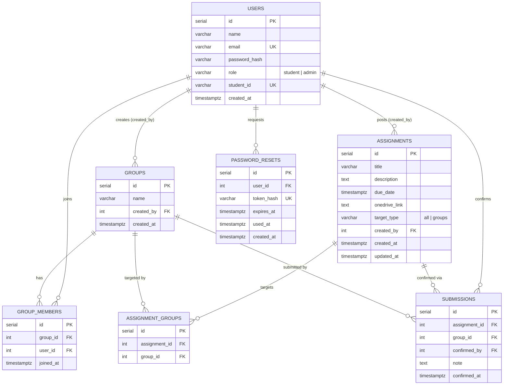

# SGAMS — Student Group & Assignment Management System

A role-based full-stack web application built for **Joineazy** that lets students form their own
groups, manage members, and confirm assignment submissions — while professors post assignments,
share OneDrive links, and track every group's progress through a unified dashboard.

## 🔑 Demo Accounts — log in immediately

| Role | Email | Password | Lands on |
|---|---|---|---|
| **Professor** (pre-seeded) | `professor@joineazy.com` | `Admin@123` | `/admin/dashboard` |
| **Student** (pre-seeded) | `alice@student.com` | `password123` | `/student/dashboard` |

Both roles use the **same login page**. The professor account is inserted automatically by the
database seed script; public registration can only ever create students.

---

## 📑 Table of Contents

1. [Overview](#overview)
2. [Tech Stack](#tech-stack)
3. [Features](#features)
4. [Demo Credentials](#demo-credentials)
5. [Setup & Run](#setup--run)
6. [API Endpoints](#api-endpoints)
7. [Database Schema](#database-schema)
8. [Architecture](#architecture)
9. [Key Design & Deployment Decisions](#key-design--deployment-decisions)
10. [Project Structure](#project-structure)

---

## Overview

SGAMS solves a simple but real coordination problem: professors upload assignment material to
OneDrive, students work in self-formed groups, and someone needs to record *"we actually submitted
it"* so the professor can see who's done without chasing everyone.

The system has two roles:

- **Student** — register/login, create and manage groups, add members by email or student ID, browse
  assignments, open OneDrive links, confirm submissions through a **two-step verification**, and
  watch group progress bars.
- **Admin / Professor** — create, edit and delete assignments, target everyone or selected groups,
  monitor group-wise and student-wise confirmations, and view analytics (charts + summary counts).

Authentication is **JWT-based** with role claims; every API route is protected and role-authorized
on the server, not just hidden in the UI.

---

## Tech Stack

| Layer | Technology |
|---|---|
| Frontend | React 18, Vite, Tailwind CSS, React Router v6, Recharts, Lucide icons, Axios |
| Backend | Node.js 18+, Express 4, PostgreSQL (`pg`), JWT, bcrypt, Helmet, CORS, Morgan |
| Containerization | Docker, Docker Compose (multi-stage frontend build + Nginx) |
| Markup | HTML5 (`index.html`, SPA shell) |

---

## Features

### Student
- Register with name, email, optional student ID and password; JWT issued on register/login.
- Create a group (creator becomes owner and first member).
- Add members by **email** or **student ID**; owners can remove members, members can leave.
- View all assignments targeted at their group(s) with due dates and OneDrive links.
- **Two-step submission confirmation**: tick *"I have submitted"* → final confirm, with an optional
  note for the professor. Confirmations can be withdrawn.
- Live progress bars / completion badges per group and per assignment.

### Admin / Professor
- Create, edit, view and delete assignments (title, description, due date, OneDrive link).
- Assign work to **all students** or to **specific groups** (multi-select).
- Track confirmations per group and per student.
- Analytics dashboard: completion percentage, stacked bar chart by assignment, donut breakdown,
  group performance table, recent submission feed.
- Protected professor-only API routes and UI.

---

## Demo Credentials

The database is seeded automatically on first boot with realistic demo data (2 groups, 6 students,
2 assignments, 1 pre-confirmed submission).

| Role | Email | Password |
|---|---|---|
| Professor | `professor@joineazy.com` | `Admin@123` |
| Student | `alice@student.com` | `password123` |
| Student | `bob@student.com` | `password123` |
| Student | `diana@student.com` | `password123` |

> The login page has one-click buttons that fill these credentials for you.

---

## Setup & Run

### Option A — Docker Compose (recommended)

```bash
# 1. Clone and enter the repository
git clone <your-repo-url> sgams && cd sgams

# 2. Create the environment file (all container variables live here)
cp .env.example .env
#    Set a strong JWT_SECRET before any real deployment.

# 3. Build and start all three services
docker compose up -d --build

# 4. Open the app
#    Frontend: http://localhost:5173
#    API:      http://localhost:5000/api/health
```

The backend automatically applies the schema and seeds demo data on startup. PostgreSQL data is
persisted in the `postgres_data` Docker volume. Stop with `docker compose down`.

> When running in Docker, the frontend build uses `VITE_API_URL=/api` and Nginx proxies `/api/*` to
> the backend container — so there are no CORS issues in production.

### Option B — Local development (no Docker)

**Prerequisites:** Node.js 18+, PostgreSQL 14+ running locally.

```bash
# 1. Create a database and user
psql -c "CREATE USER sgams_user WITH PASSWORD 'sgams_password';"
psql -c "CREATE DATABASE sgams OWNER sgams_user;"

# 2. Backend
cd backend
cp .env.example .env          # set DB_* and JWT_SECRET for your local DB
npm install
npm run db:init               # applies schema.sql + seeds demo data
npm run dev                   # http://localhost:5000

# 3. Frontend (new terminal)
cd frontend
cp .env.example .env          # VITE_API_URL=http://localhost:5000/api
npm install
npm run dev                   # http://localhost:5173
```

Useful scripts:

| Command | Location | Purpose |
|---|---|---|
| `npm run dev` | backend / frontend | Start with hot reload |
| `npm start` | backend | Start in production mode |
| `npm run db:init` | backend | Re-apply schema + seed (idempotent) |
| `npm run build` | frontend | Produce optimized `dist/` |

---

## API Endpoints

Base URL: `http://localhost:5000/api`
All protected routes require `Authorization: Bearer <JWT>`.

### Authentication — `/api/auth`
| Method | Endpoint | Access | Description |
|---|---|---|---|
| POST | `/register` | Public | Body: `{ name, email, password, studentId? }` — **always creates a student** |
| POST | `/login` | Public | Body: `{ email, password }` → `{ token, user }`; the JWT contains `{ id, role }` |
| POST | `/forgot-password` | Public | Body: `{ email }` → generates a single-use token (returned in the response for this demo) |
| POST | `/reset-password` | Public | Body: `{ token, password }` — token valid 15 minutes, one use |
| GET | `/me` | Auth | Current user profile |

**No admin self-registration.** `POST /api/auth/register` ignores any `role` field and always writes
`role = 'student'`. The professor account is created by `backend/src/db/seed.js` on first boot with a
bcrypt hash of `ADMIN_SEED_PASSWORD` (default `Admin@123`). After login the frontend reads `user.role`
and routes admins to `/admin/dashboard` and students to `/student/dashboard`.

> Password reset is token-based: `password_resets` stores only a SHA-256 hash of a random token, with a
> 15-minute expiry and a `used_at` marker. Because there is no mail server in this demo, the token is
> returned in the API response and shown on the forgot-password screen.

### Groups — `/api/groups`
| Method | Endpoint | Access | Description |
|---|---|---|---|
| GET | `/` | Auth | Groups the current user belongs to (with member count + progress) |
| POST | `/` | Auth | Create group `{ name }` |
| GET | `/:id` | Auth (member) | Group details with members and progress |
| PUT | `/:id` | Auth (owner) | Rename `{ name }` |
| DELETE | `/:id` | Auth (owner) | Delete group |
| POST | `/:id/members` | Auth (member) | Add `{ email }` or `{ studentId }` |
| DELETE | `/:id/members/:userId` | Auth (owner/self) | Remove a member / leave |

### Assignments — `/api/assignments`
| Method | Endpoint | Access | Description |
|---|---|---|---|
| GET | `/` | Auth | Assignments visible to the user (admin sees all), enriched with stats |
| GET | `/:id` | Auth | Single assignment |
| POST | `/` | Admin | Create assignment |
| PUT | `/:id` | Admin | Edit assignment |
| DELETE | `/:id` | Admin | Delete assignment |

Create/update body:
```json
{
  "title": "Week 4 – Database Design",
  "description": "Submit your ER diagram.",
  "dueDate": "2026-12-01T23:59:00Z",
  "oneDriveLink": "https://onedrive.live.com/...",
  "targetType": "all",              // or "groups"
  "groupIds": [1, 3]                // required when targetType = "groups"
}
```

### Submissions — `/api/submissions`
| Method | Endpoint | Access | Description |
|---|---|---|---|
| POST | `/` | Auth (member) | Confirm `{ assignmentId, groupId, confirm: true, note? }` — `confirm: true` is the **second step** |
| GET | `/assignment/:assignmentId` | Auth | Confirmations for an assignment (students see only their groups) |
| DELETE | `/:assignmentId/:groupId` | Auth (member/admin) | Withdraw a confirmation |
| GET | `/my-progress` | Student | Progress summary across the student's groups |

### Professor analytics — `/api/admin`
| Method | Endpoint | Access | Description |
|---|---|---|---|
| GET | `/overview` | Admin | Counts + recent submissions |
| GET | `/analytics` | Admin | Per-assignment and per-group breakdown, completion % |
| GET | `/groups` | Admin | All groups with progress |
| GET | `/students` | Admin | All students with group/confirmation counts |

### Health check
`GET /api/health` → `{ "success": true, "status": "ok", ... }`

**Standard response shape:** `{ "success": true, ...data }` or
`{ "success": false, "message": "..." }` with an appropriate HTTP status code.

---

## Database Schema

Six normalized tables. Passwords are stored as bcrypt hashes (never plaintext).

### ER Diagram



### Relationship notes

- `GROUP_MEMBERS` and `ASSIGNMENT_GROUPS` are join tables resolving the many-to-many relationships
  *(user ↔ group)* and *(assignment ↔ group)*, each with a `UNIQUE` constraint to prevent duplicates.
- `SUBMISSIONS` has `UNIQUE(assignment_id, group_id)` — a group can confirm an assignment only once.
- When `assignments.target_type = 'all'`, every existing group is treated as a target (computed in
  queries, no rows needed in `assignment_groups`). When it is `'groups'`, only rows in
  `assignment_groups` count.
- Foreign keys use `ON DELETE CASCADE` so removing a group/assignment/user cleans up dependent rows
  automatically.
- Indexes on all foreign keys keep dashboard aggregation queries fast.

The authoritative DDL lives in [`backend/src/db/schema.sql`](backend/src/db/schema.sql), and the
idempotent demo seed in [`backend/src/db/seed.js`](backend/src/db/seed.js).

---

## Architecture

```
┌──────────────────────┐        HTTPS / JSON (JWT)        ┌────────────────────────┐
│  React SPA (Vite)    │  ───────────────────────────────▶ │  Express REST API      │
│  Tailwind + Router   │  ◀─────────────────────────────── │  Controllers + Services│
│  Recharts dashboards │        { success, data }          │  Auth / Role middleware│
└──────────┬───────────┘                                   └───────────┬────────────┘
           │ Nginx serves static build + proxies /api                  │ parameterized SQL
           ▼                                                          ▼
   [ Browser / Port 5173 ]                                    ┌────────────────────┐
                                                              │   PostgreSQL 16    │
                                                              │  (persistent vol.) │
                                                              └────────────────────┘
```

### Request flow (example: confirm a submission)

1. Student clicks **Confirm submission** (step 1) → acknowledges → **Final confirm** (step 2).
2. Frontend calls `POST /api/submissions` with `{ assignmentId, groupId, confirm: true, note }`
   and the JWT in the `Authorization` header (added by the Axios interceptor).
3. `protect` middleware verifies the JWT and loads the user; the controller checks that the
   assignment targets the group and that the user is a member.
4. A single `INSERT` into `submissions` runs (the `UNIQUE` constraint prevents double confirmation).
5. The UI reloads assignments and progress bars; the professor's dashboard reflects the new count
   on its next fetch.

### Modular backend layers

- **config/** — environment + shared PostgreSQL pool and transaction helper.
- **middleware/** — JWT authentication, role authorization, centralized error handling, 404.
- **controllers/** — request validation, business rules, SQL queries, response shaping.
- **routes/** — thin routing layer mapping URLs to controllers with the right guards.
- **utils/** — JWT/password helpers, API errors, async wrapper, progress/visibility helpers.
- **db/** — SQL schema, seed data, initializer.

### State & data flow on the frontend

- `AuthContext` holds the user/token, persists them in `localStorage`, validates the token on mount,
  and reacts to global `auth:logout` events fired by the Axios 401 interceptor.
- `ProtectedRoute` guards role-specific areas; `Layout` renders role-aware navigation.
- API modules in `src/api/` centralize every endpoint; pages only call these functions.

---

## Key Design & Deployment Decisions

| Decision | Rationale |
|---|---|
| **Two-step confirmation at the API level** | `confirm: true` must be sent explicitly, so an accidental single click or a direct API call cannot record a submission. |
| **No admin self-registration** | Public `/register` always writes `role = 'student'`, so a student cannot escalate privileges. The professor account is pre-seeded by `seed.js` with a bcrypt-hashed password. |
| **Role checks on the server** | Hiding admin screens in React is not security; every admin route re-verifies the `admin` role from the JWT and DB. |
| **Target model (`all` vs `groups`)** | Avoids duplicating rows for "everyone" while still allowing precise group targeting; visibility is computed in one helper. |
| **Progress computed in SQL** | Aggregation (`COUNT DISTINCT`, `ANY(int[])`) keeps the client dumb and avoids N+1 request storms. |
| **Centralized error envelope** | A consistent `{ success, message }` shape with proper status codes makes the frontend predictable. |
| **Transactions for multi-step writes** | Creating an assignment + its group links, or a group + its first member, either fully commits or fully rolls back. |
| **bcrypt (12 rounds) + JWT expiry** | Passwords are never stored in plaintext; tokens expire (`JWT_EXPIRES_IN`, default 7d). |
| **Single-use reset tokens** | Forgot-password tokens are random, hashed at rest (SHA-256), expire after 15 minutes and are marked used after one reset. |
| **Multi-stage frontend build + Nginx** | Small production image; Nginx serves the SPA, handles the React Router fallback (`try_files`) and proxies `/api` to the backend. |
| **Compose healthcheck** | The backend waits for PostgreSQL to be genuinely ready before starting, avoiding startup races. |
| **Volume for Postgres** | Submissions survive container restarts/rebuilds. |

### Suggested improvements for production
- Refresh-token rotation and short-lived access tokens.
- Rate limiting on auth routes and CSRF protection if cookie-based auth is adopted.
- Server-side pagination for large assignment/group lists and PostgreSQL row-level security.
- Real email invitations instead of adding existing accounts by identifier.

---

## Project Structure

```
.
├── docker-compose.yml           # db + backend + frontend orchestration
├── .env.example                 # compose-level variables
├── README.md                    # this document
├── backend/
│   ├── Dockerfile
│   ├── .env.example
│   ├── package.json
│   └── src/
│       ├── server.js            # startup, schema init, graceful shutdown
│       ├── app.js               # Express app, middleware, route mounting
│       ├── config/              # env + PostgreSQL pool + transactions
│       ├── controllers/         # auth, group, assignment, submission, admin
│       ├── db/                  # schema.sql, seed.js, init.js
│       ├── middleware/          # auth, errorHandler
│       ├── routes/              # five route modules
│       └── utils/               # jwt, password, validate, helpers, errors
└── frontend/
    ├── Dockerfile               # multi-stage build → Nginx
    ├── nginx.conf               # SPA fallback + /api proxy
    ├── index.html
    ├── package.json
    ├── tailwind.config.js
    ├── postcss.config.js
    ├── vite.config.js
    └── src/
        ├── main.jsx, App.jsx, index.css
        ├── api/                 # axios client + endpoint modules
        ├── components/          # Layout, ProtectedRoute, reusable UI
        ├── context/             # AuthContext
        ├── pages/               # auth, dashboards, groups, assignments, admin
        └── utils/               # date/format helpers
```

---

**Built as the Full Stack Intern technical assignment for Joineazy — November 2026.**
